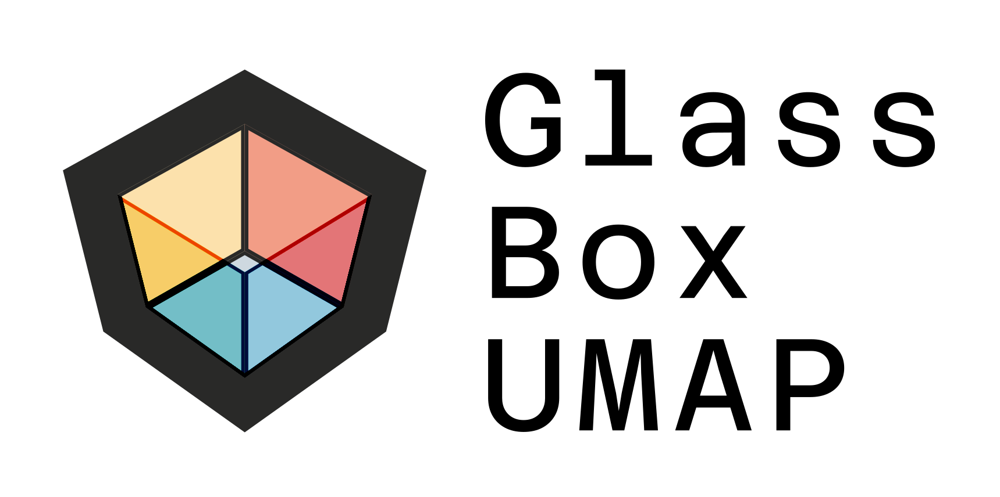

# Glass Box UMAP

Glass Box UMAP augments UMAP by computing exact feature contributions to the UMAP embedding.

Standard UMAP produces embeddings but offers no insight into why points land where they do. Glass Box UMAP solves this by using a specially designed neural network that enables exact computation of feature contributions, and does so without approximations. The feature contributions are mathematically exact, validated to near machine precision.

# Documentation

All resources are hosted at [https://glass-box-umap.readthedocs.io](https://glass-box-umap.readthedocs.io).

**Quick links**:

1. [**Installation**](https://glass-box-umap.readthedocs.io/en/latest/user_guide/install.html)
1. [Basic usage](https://glass-box-umap.readthedocs.io/en/latest/user_guide/basic_usage.html)
1. [Citation](https://glass-box-umap.readthedocs.io/en/latest/meta/citation.html)

# Fitting many embeddings

If you fit many datasets, these choices matter more than anything else for speed:

- **Reuse one process for many fits.** The first fit in a new Python process compiles pynndescent's and umap-learn's numba code, which takes about 20 seconds even for a five-sample input. Later fits in the same process skip it.
- **For inputs under a few thousand samples, run several single-thread processes.** Call `torch.set_num_threads(1)` in each worker and run one worker per CPU. Small fits can't use many threads, so this gets about 1.6 times as many fits per machine as running one multi-threaded fit at a time. Larger inputs use threads well: give each fit all of them when you need it to finish quickly.
- **If each fit has to run in a new process,** pass `neighbor_search="auto"`. Below 4,096 samples it finds exact nearest neighbors with PyTorch instead of pynndescent, so nothing is compiled. Embeddings differ slightly from the default's, because pynndescent's neighbors are approximate.

By default, `fit` trains with a plain PyTorch loop and writes no files. To get TensorBoard logs and checkpoints, set `checkpoint_dir` or pass `trainer="lightning"`; both trainers give the same embedding for the same `random_state`.

# Acknowledgements

* Thank you to Leland McInnes, Tim Sainburg, Timothy Gentner, and Francois Chollet for their work on [parametric UMAP](https://arxiv.org/abs/2009.12981). Special thanks to Leland McInnes for maintaining [umap-learn](https://umap-learn.readthedocs.io/en/latest/), and all other contributors, whose work has made this project possible.
* Glass Box UMAP is part of [Arcadia Science's](https://www.arcadiascience.com/) commitment to open, reproducible research tools.
